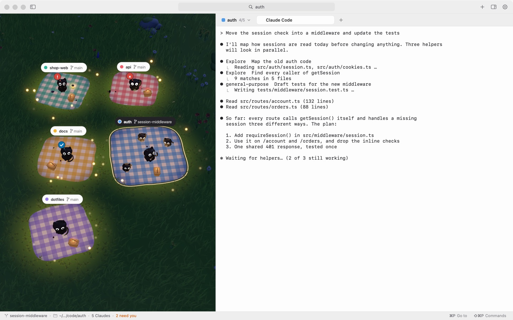
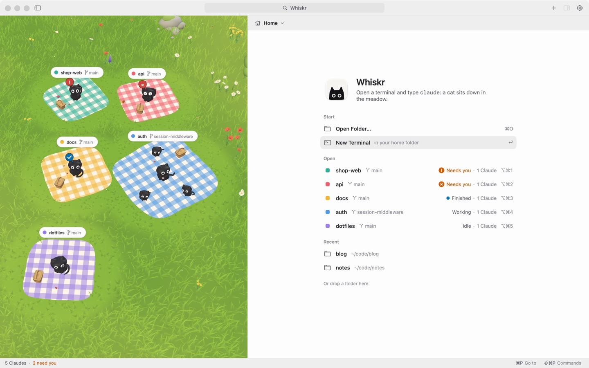

# Whiskr

A terminal for [Claude Code](https://docs.claude.com/en/docs/claude-code/overview) on the Mac, with a meadow
where the sidebar would be.

Whiskr is a native macOS terminal multiplexer: workspaces, tabs and split panes of real terminals. Down the
left side is a small 3D clay meadow with one picnic blanket per workspace. Wherever you start `claude`, a
black cat sits down on that workspace's blanket and acts out what Claude is doing. Its helpers sit beside
it. When a cat stands up with a paw raised, Claude needs you.






<sub>Screenshots from the app's built-in demo (Debug builds, `--demo`): the cats are driven by real hook
events, and the terminal text is illustrative.</sub>

> **Status: pre-release.** There is no published build yet. The app is unsigned and not notarised, and the
> only way to run it today is to build it yourself. See [docs/RELEASING.md](docs/RELEASING.md).

## Features

- **A real terminal app.** Workspaces (one per folder), tabs, and panes split any way you like. Terminals
  are drawn by [SwiftTerm](https://github.com/migueldeicaza/SwiftTerm). There is no web view and no Node.
- **The meadow shows what each Claude is doing.** A request stands tall with "!", an error shows "×", and a
  turn that finished while you looked away sits still with "✓" until you have seen it. Working cats read,
  edit, run and search. Idle ones loaf, then nap. Every state differs in shape as well as colour.
- **Nothing to set up.** Type `claude` in any pane and its cat appears. Your `~/.claude` settings, your
  `CLAUDE.md` and your shell files are never changed (see [How it works](#how-it-works)).
- **Sessions outlive the app.** Terminals belong to a small session host inside the app, so quitting (⌘Q)
  leaves everything running, Claude included. The next launch opens on Home, with every workspace back as
  it was and one click away.
- **Attention without interruption.** ⌘J goes to the oldest request, then the oldest finished turn. Three
  soft sounds while you are in the app. Notifications with Allow and Deny while you are away. A Dock badge.
  Nothing an agent does ever moves the window, the focus, a tab or the camera.
- **Answer from the meadow.** Click a requesting cat whose terminal is not on screen and answer it from a
  card (1 Allow, 2 Deny), or go to its terminal.
- **Files and changes.** A file tree and git changes beside the terminals (stage, unstage, discard,
  commit). A light editor with syntax colouring, find and replace. Markdown, image and PDF previews, and
  diffs side by side or inline. Files Claude edits reload by themselves.
- **Worktrees.** Each git worktree is a workspace of its own. Its blanket is joined to its repository's by
  stepping stones.
- **Agents steering agents.** Every terminal has `paw` on its PATH, so Claude can start helper terminals,
  send them work and wait for them (see [`paw`](#paw)).
- **A Mac app.** Menus with every command and its key, a command palette (⇧⌘P), Go to (⌘P), themes
  (including your own and iTerm2 colour files), English and Japanese, and VoiceOver labels.

## Requirements

- macOS 26 (Tahoe) to build. The app's deployment target is macOS 15.
- Xcode 26.1 or later (Swift 6.2).
- [XcodeGen](https://github.com/yonaskolb/XcodeGen), only if you change `native/App/project.yml`
  (`brew install xcodegen`). The generated project is checked in.
- Claude Code installed and on your PATH, for the cats to have something to do.

## Build and run

```sh
cd native/App
make run        # build (Debug) and open the app
make test       # the logic tests: the Kit and the meadow scene (Swift Testing)
make release    # the Release configuration
make dist       # an unsigned, zipped Release build and its SHA-256 checksum
```

Builds go to `~/Library/Developer/Xcode/DerivedData/Whiskr-make`, and tests and archives go to
`~/Library/Developer/Whiskr`. Both are outside the source tree, so nothing runs from inside folders macOS
guards, such as `~/Desktop` or `~/Documents`. Override either with `DERIVED=` or `SCRATCH=`. You can also
open `native/App/Whiskr.xcodeproj` in Xcode. The first build asks you to trust SwiftTerm's small build
plugin.

## How sessions survive quitting

The window is only a client. Every terminal belongs to the **session host**, a small process inside the
app (`Whiskr.app/Contents/MacOS/whiskr-host`) that the app starts on demand, in a session of its own. When
the app quits, crashes or is replaced by a new build, the host and every program in it keep running. The
next launch reattaches each pane to its terminal and replays its screen.

- **Quit (⌘Q)** saves the layout and leaves everything running. It asks nothing.
- **Quit and Stop All Terminals (⌥⌘Q)** ends them. It asks only when Claude or another program is
  running.
- **After a restart of the Mac**, panes come back as fresh shells in their folders. Claude panes type
  `claude --resume <id>` and wait for you.
- With no terminal running and no window connected, the host exits by itself after 30 seconds.

The host listens on a Unix socket in `~/Library/Application Support/Whiskr/host/`. Only you can open that
folder, and the host checks who connects. See [SECURITY.md](SECURITY.md) for the trust model.

## How it works

Each pane's shell finds a small `claude` shim first on its PATH. The shim runs the real Claude Code with
this pane's hooks (`--settings`): command hooks that post each event to the app. A cat appears as soon as
Claude is the terminal's foreground program, before any hook fires. Outside Whiskr's terminals the shim is
not on PATH. With the app gone, the hooks do nothing.

## `paw`

`paw` is a command-line tool on every Whiskr terminal's PATH. Claude (or you) can use it to start and steer
other terminals:

```sh
paw run --name review claude "Review the diff on this branch"   # a helper terminal with a task
paw send review "Also check the tests"                             # type into it
paw wait review                                                    # until it settles
paw read review                                                    # what is on its screen
paw ls                                                             # terminals and their state
paw kill review
```

A terminal started with `paw run` is a helper cat on its boss's blanket. `paw --help` lists every command
and option. `paw --skill` prints a short manual written for agents, and Claude is told about it when a
session starts.

## Keyboard

| Keys | Does |
|---|---|
| ⇧⌘H | Home: open a folder or a terminal, or go back into a workspace |
| ⌘N / ⌘O / ⌘T | New workspace (Home) / open a folder / new tab |
| ⌘D / ⇧⌘D | Split right / split down |
| ⌘W / ⌥⌘W | Close pane / close tab (⌘Z brings it back for ten seconds, ⇧⌘T later) |
| ⌘J | Next request, then the next finished turn |
| ⌘P / ⇧⌘P | Go to anything / command palette |
| ⌘1…9 / ⌥⌘1…9 | Tabs / workspaces |
| ⌘[ ⌘] and ⌥⌘arrows | Panes |
| ⇧⌘↩ | Zoom the pane |
| ⌥⌘0 | Keyboard into the meadow (arrows, Return, Esc) |
| ⌃⌘1 / ⌃⌘2 / ⌃⌘3 / ⌃⌘S | Meadow and terminals / terminals only / meadow only / hide the meadow |
| ⇧⌘E / ⇧⌘C | Files / git changes beside the terminals |
| ⌘? | Help: reading the meadow |

Every command is also in the menus, where System Settings › Keyboard › Keyboard Shortcuts can rebind it.

## Repository layout

| Path | What |
|---|---|
| `native/App/Whiskr/` | The app: window, menus, meadow region, tabs and panes, files, editor (AppKit and SwiftUI) |
| `native/App/WhiskrKit/` | Everything testable without a window: the model of Claudes and helpers, hooks, syntax colouring, diffs, git, the session host (`TerminalHost`), `paw` |
| `native/App/WhiskrHost/` | The session host's `main` |
| `native/Scene/` | The meadow: a Swift package with its own small Metal renderer (`MeadowScene`) |
| `docs/` | [Architecture](docs/ARCHITECTURE.md), [design and look rules](docs/DESIGN.md), [releasing](docs/RELEASING.md), the icon source |

## Contributing

Bug reports, ideas and pull requests are welcome. Start with [CONTRIBUTING.md](CONTRIBUTING.md). If you
work with an AI coding agent, point it at [AGENTS.md](AGENTS.md). Please report security problems privately
([SECURITY.md](SECURITY.md)).

## Licence, and what it allows

Whiskr is licensed under the [Apache License 2.0](LICENSE). Copyright 2026 Whiskr contributors.

In short (the licence text is what counts):

- You may use, copy, modify and distribute Whiskr, including commercially. You may also include it in your
  own work under other terms.
- If you distribute it or work based on it, you must include a copy of the licence and the [NOTICE](NOTICE)
  file. You must keep the copyright and attribution notices. You must state in modified files that you
  changed them.
- The licence includes a patent grant from contributors. That grant ends for anyone who sues over patents
  in the work.
- **The name and the artwork are not part of the grant.** Section 6 of the licence gives no permission to
  use the name "Whiskr", the app icon or the cat character as marks for your own product, except to
  describe where your work comes from. If you ship a fork, give it a different name and icon so nobody
  takes it for this project.
- There is no warranty.

Third-party components keep their own licences. They are listed in [NOTICE](NOTICE).
